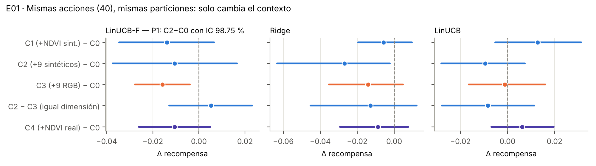
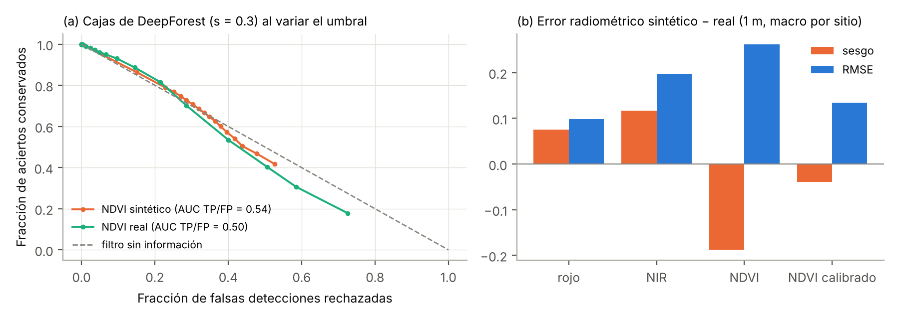
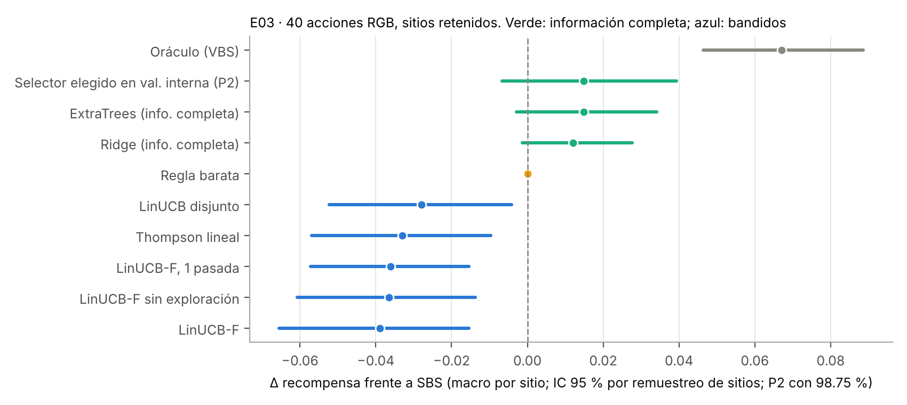
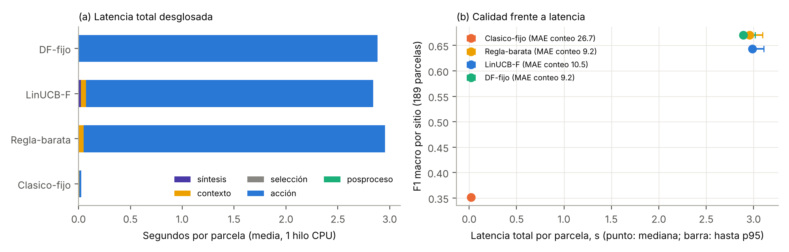
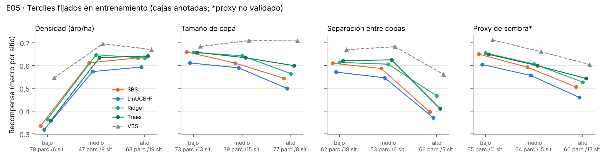
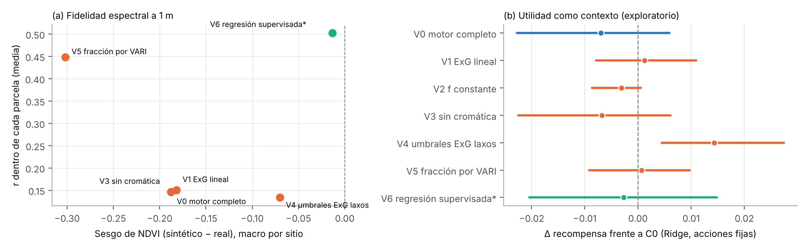
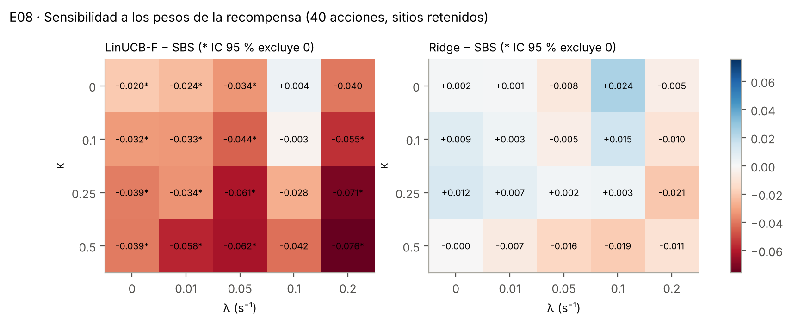
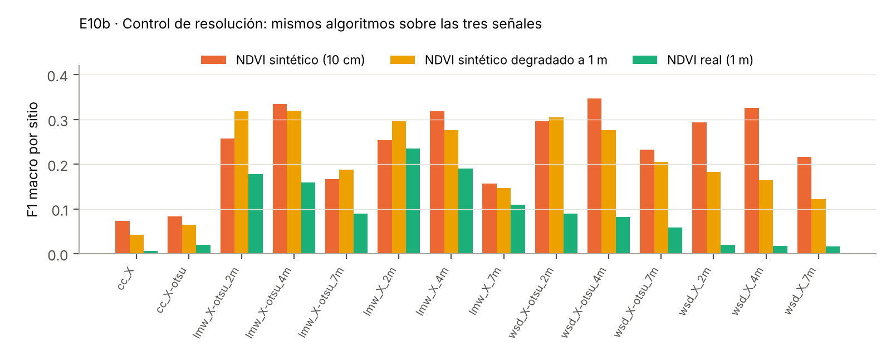

# SpecTree: resultados de los experimentos E00–E10

**Fecha:** 19 de octubre de 2026.
**Plan:** `EXPERIMENTOS_FALTANTES_SPECTREE.md`.
**Pre-registro:** [`experiments/spectree/preregistro.md`](../../experiments/spectree/preregistro.md), commit `fd339fa`. Se fijó antes de ejecutar cualquier prueba.
**Notas y desviaciones:** [`run_notes.md`](../../experiments/spectree/run_notes.md).

> **Advertencia.** Todos los análisis se hicieron sobre NeonTreeEvaluation, un benchmark que ya se había inspeccionado al escribir el artículo. Son análisis sobre datos vistos, no una confirmación independiente. E07 es la única vía hacia una confirmación externa.

**Configuración común:**
- 189 parcelas de 20 sitios NEON;
- 4 proyecciones nominales por parcela;
- portafolio principal de **40 acciones ejecutables desde RGB**;
- 5 particiones agrupadas por sitio, las mismas de la v0.5;
- 5 semillas.

**Métrica primaria:** la recompensa $r=\mathrm{F1}-0.25\min(1,e)$ con IoU ≥ 0.4, en promedio macro por sitio (sensores y semillas → parcela → sitio). Los intervalos de confianza del 95 % salen de 5 000 remuestreos pareados de **sitios**.

## Veredicto de las comparaciones primarias

Cada comparación primaria lleva un intervalo de Bonferroni al 98.75 %. El margen de relevancia es δ = 0.02.

| | Comparación | Estimación [IC] | Veredicto |
|---|---|---|---|
| **P1** (E01) | Contexto C2 (RGB + 9 atributos sintéticos) frente a C0 (solo RGB), con LinUCB-F y 40 acciones | −0.010 [−0.037, +0.016] | **No respaldada** (inconclusa, con estimación negativa) |
| **P2** (E03) | Selector elegido en validación interna frente a SBS | +0.015 [−0.007, +0.039] | **Inconclusa** |
| **P3** (E02) | Filtro sintético calibrado con umbral ajustado frente a DeepForest sin filtro (ΔF1) | 0.000 [0, 0] | **No respaldada**: el umbral óptimo es «no filtrar» |
| **P4** (E04) | LinUCB-F frente a DeepForest fijo: no inferioridad y menor latencia | ΔF1 −0.028 [−0.063, −0.000]; MAE ×1.13; Δt −0.04 s [−0.35, +0.14] | **No respaldada**: falla en F1 y en MAE; la menor latencia es inconclusa |

Ninguna de las cuatro afirmaciones centrales del sistema queda respaldada. La evidencia apunta en una dirección consistente:
- el portafolio sí contiene margen de selección (el VBS supera al SBS en +0.067 [+0.046, +0.089]);
- los atributos derivados de la síntesis espectral no ayudan a aprovecharlo;
- el régimen de bandido con 40 acciones es el componente que más pierde;
- los selectores con información completa (Ridge, ExtraTrees) quedan por encima del SBS en promedio, pero sin evidencia concluyente.

---

## E00: reproducción e incertidumbre

**Reproducción.** Se regeneraron las 58 acciones en los 756 contextos guardando cajas, puntuaciones previas al filtro, contextos y tiempos. El número de cajas coincide con la tabla de la v0.5 en el 100 % de los casos, con $|\Delta\mathrm{F1}|\le10^{-4}$.

**Tabla principal** (portafolio RGB de 40 acciones, sitios retenidos; [`e00_resumen_rgb40.csv`](e00_resumen_rgb40.csv)):

| Política | Información | Recompensa macro | micro | F1 macro | F1 micro | MAE conteo | Inventario | Δ frente a SBS [IC 95 %] | Brecha cerrada |
|---|---|---|---|---|---|---|---|---|---|
| VBS (oráculo) | prueba | 0.674 | 0.706 | 0.707 | 0.704 | 5.7 | −13 % | +0.067 [+0.046, +0.089] | 100 % |
| Ridge | completa | 0.619 | 0.622 | 0.675 | 0.676 | 9.2 | −20 % | +0.012 [−0.001, +0.028] | 18 % |
| **SBS** | fijo | **0.607** | 0.619 | 0.671 | 0.680 | 9.2 | −16 % | — | 0 % |
| LinUCB | bandido | 0.579 | 0.574 | 0.650 | 0.650 | 10.9 | −22 % | −0.028 [−0.052, −0.004] | −42 % |
| Thompson | bandido | 0.573 | 0.541 | 0.645 | 0.629 | 11.3 | −24 % | −0.033 [−0.057, −0.010] | −49 % |
| LinUCB-F | bandido | 0.568 | 0.584 | 0.642 | 0.653 | 10.6 | −21 % | −0.039 [−0.066, −0.015] | −58 % |
| Aleatorio | ninguna | 0.169 | 0.076 | 0.310 | 0.283 | 28.6 | +12 % | −0.437 | — |

- **Los bandidos pierden frente al SBS.** Las tres variantes quedan por debajo de la mejor acción fija con intervalos que excluyen el cero. La dispersión entre semillas es pequeña (desviación estándar 0.004–0.014) frente a la variación entre sitios.
- **Resultados por sitio.** [`e00_por_sitio.csv`](e00_por_sitio.csv) muestra que la diferencia de LinUCB-F frente al SBS cambia de signo entre sitios: va de −0.17 (SERC, SOAP) a +0.04 (DELA, SCBI).
- **Portafolio de 58 acciones.** El de referencia, que incluye hiperespectral, da prácticamente lo mismo ([`e00_resumen_all58.csv`](e00_resumen_all58.csv)).

**Archivos de trazabilidad.** El plan pide `splits.json`, `actions.csv`, `features.json`, `config.yaml` (con el SHA-256 del checkpoint), `data_manifest.csv`, `summary_by_site.csv`, `timings.csv` y `policy_decisions.csv`. Están en [`trazabilidad/`](trazabilidad/), salvo los dos archivos grandes regenerables (ver [Reproducir](#reproducir)).

## E01: ¿la síntesis mejora el contexto o solo añade variables?

Se mantuvieron las mismas 40 acciones, recompensas y particiones. Solo cambió el contexto:
- **C0:** 21 atributos RGB;
- **C1:** C0 más 3 estadísticos de NDVI sintético;
- **C2:** C0 más 9 atributos sintéticos;
- **C3:** C0 más 9 transformaciones RGB simples, de igual dimensión que C2;
- **C4:** C0 más NDVI real (diagnóstico).



| Selector | C0 | C1 | C2 | C3 | C4 |
|---|---|---|---|---|---|
| LinUCB-F | 0.592 | 0.578 | 0.582 | 0.576 | 0.582 |
| Ridge | **0.624** | 0.619 | 0.597 | 0.610 | 0.616 |
| LinUCB | 0.575 | 0.587 | 0.565 | 0.573 | 0.581 |

*Recompensa macro por sitio. SBS = 0.607. Fuente: [`e01_resumen.csv`](e01_resumen.csv) y [`e01_comparaciones.csv`](e01_comparaciones.csv).*

**Lectura.**
- **Ningún contexto con atributos sintéticos supera a C0 (solo RGB) de forma concluyente con ningún selector.** La única mejora puntual es C1 con LinUCB (+0.013 [−0.005, +0.031]), cuyo intervalo contiene el cero. Con Ridge, C2 es peor que C0: −0.027 [−0.063, −0.002].
- **No hay ventaja específica de la síntesis frente a transformaciones RGB de igual dimensión.** C2 − C3 da +0.005 [−0.013, +0.023] con LinUCB-F y −0.013 [−0.045, +0.012] con Ridge.
- **Ni siquiera el NDVI medido mejora la selección.** C4 − C0 da −0.011 con LinUCB-F y −0.009 con Ridge, ambos con intervalos que contienen el cero. El límite no está en la fidelidad del NDVI sino en lo poco que el NDVI informa sobre qué método conviene.
- **El mejor selector observado no usa síntesis.** Es Ridge con contexto solo RGB: +0.018 [+0.003, +0.036] frente al SBS. Es exploratorio, porque esta comparación no estaba pre-registrada como primaria.

Este resultado permite afirmar que, bajo este protocolo, **los atributos sintéticos no aportan utilidad predictiva para seleccionar** frente a RGB ni frente a un control de igual complejidad. No permite afirmar que la representación espectral sea inútil para otras tareas, como la clasificación de especies o el estado sanitario.

## E02: calibración radiométrica frente a utilidad del filtro

Se usaron las mismas cajas y puntuaciones de DeepForest, guardadas antes del filtro. Los umbrales y la calibración se ajustaron solo con los sitios de entrenamiento.



| Variante | F1 macro | Exhaustividad | Precisión | MAE conteo | ΔF1 frente a sin filtro [IC] |
|---|---|---|---|---|---|
| F0 sin filtro | 0.671 | 0.669 | 0.707 | 9.2 | — |
| F1 sintético, umbral 0.3 (original) | **0.597** | 0.594 | 0.653 | 14.6 | −0.074 [−0.153, −0.017] |
| F2 sintético, umbral ajustado | 0.671 | 0.669 | 0.707 | 9.2 | 0 (umbral elegido: «sin filtro» en las 5 particiones) |
| F3a calibrado, umbral 0.3 | 0.671 | | | 9.2 | 0 (no descarta nada, ver nota) |
| F3b calibrado, umbral ajustado (P3) | 0.671 | | | 9.2 | 0 [0, 0] |
| F4a NDVI real, umbral 0.3 | 0.670 | 0.667 | 0.707 | 9.2 | −0.001 [−0.001, 0.000] |
| F4b NDVI real, umbral ajustado | 0.671 | | | 9.2 | 0 |

**Mecanismo.** La mediana de NDVI dentro de cada caja **no discrimina** los aciertos de las falsas detecciones de DeepForest:
- el AUC TP/FP es **0.54** con NDVI sintético y **0.50** con NDVI real;
- con umbral 0.3, el filtro sintético descarta el 25 % de los aciertos y el 27 % de las falsas detecciones, que es prácticamente la diagonal de un filtro aleatorio ([`e02_atribucion.csv`](e02_atribucion.csv)).

**Calibración.** La calibración lineal ajustada en entrenamiento corrige la escala:
- el sesgo del NDVI pasa de −0.188 a −0.039;
- el RMSE pasa de 0.262 a 0.135.

Pero no cambia la decisión, porque un umbral sobre una transformación monótona ordena las cajas igual. El umbral 0.3 sobre el NDVI calibrado no descarta nada porque el NDVI calibrado nunca baja de ≈ 0.4 (intercepto 0.44, pendiente 0.5).

**Errores radiométricos a 1 m** (macro por sitio):

| Magnitud | Sesgo | RMSE |
|---|---|---|
| Rojo | +0.076 | 0.098 |
| NIR | +0.117 | 0.198 |
| NDVI | −0.188 | 0.262 |
| NDVI calibrado | −0.039 | 0.135 |

**Lectura.** Mejorar la fidelidad radiométrica (RMSE ÷ 2) no mejora el conteo. El filtro falla **porque el índice no discrimina**, no por la escala. Hay que retirar el filtro del método operativo. El índice, en cambio, puede seguir evaluándose como descriptor.

## E03: ¿qué limita al selector?

Contexto de la v0.5 (25 atributos) y 40 acciones constantes. En prueba, todas las políticas deciden por la recompensa media predicha, con los parámetros congelados.



| Política | Información | Recompensa | Δ frente a SBS [IC 95 %] |
|---|---|---|---|
| VBS | prueba | 0.674 | +0.067 [+0.046, +0.089] |
| Selector elegido en validación interna (P2) | completa | 0.621 | +0.015 [−0.007, +0.039] (IC 98.75 %) |
| ExtraTrees (4 configuraciones, validación interna) | completa | 0.621 | +0.015 [−0.003, +0.034] |
| Ridge | completa | 0.619 | +0.012 [−0.001, +0.028] |
| Regla barata (un atributo RGB decide clásico o DeepForest) | completa | 0.607 | 0.000 (con λ = 0 siempre elige DeepForest) |
| LinUCB disjunto | bandido | 0.579 | −0.028 [−0.052, −0.004] |
| LinUCB-F, una pasada | bandido | 0.570 | −0.036 [−0.057, −0.015] |
| LinUCB-F sin exploración (α = 0) | bandido | 0.570 | −0.036 [−0.061, −0.014] |
| LinUCB-F (tres pasadas, α = 0.5) | bandido | 0.568 | −0.039 [−0.066, −0.015] |

**Lectura.**
1. **El régimen de aprendizaje importa más que el modelo.** Con información completa, los selectores quedan por encima del SBS en promedio, aunque sin intervalo concluyente. Todos los bandidos quedan por debajo, con intervalos que excluyen el cero. En la validación interna gana ExtraTrees en 4 de las 5 particiones y la regla barata en una ([`e03_seleccion_interna.csv`](e03_seleccion_interna.csv)).
2. **La exploración no aporta nada.** Una pasada, tres pasadas y α = 0 dan resultados indistinguibles. En la partición 0, tres pasadas consultan 1 536 veces, pero solo cubren 1 213 pares contexto–acción únicos de 20 480 posibles: la tabla se reconsulta, no se amplía.
3. **La factorización no compensa.** LinUCB-F mantiene 468 coeficientes, pero su matriz de covarianza tiene 219 024 entradas, frente a 27 040 del LinUCB disjunto. Cada decisión le cuesta 0.53 ms, frente a 0.04 ms. Y no es mejor que el disjunto.
4. **La curva de aprendizaje está limitada por datos.** Con 10, 20, 40, 80 y todas las parcelas de entrenamiento:
   - Ridge pasa de 0.529 a 0.619;
   - LinUCB-F pasa de 0.531 a 0.568;
   - el SBS se mantiene entre 0.60 y 0.62.

   Ridge solo alcanza al SBS con todos los datos ([`e03_curva_aprendizaje.csv`](e03_curva_aprendizaje.csv)).
5. **De dónde sale la pérdida del bandido** (E10e; [`e10e_descomposicion_perdida.csv`](e10e_descomposicion_perdida.csv)). LinUCB-F pierde −0.035 de recompensa frente al SBS, en media por contexto:
   - **−0.017** por elegir el filtro sintético de DeepForest (25 % de las decisiones);
   - **−0.010** por elegir otro umbral de DeepForest (42 %);
   - **−0.007** por pasar a un método clásico (solo el 1.9 % de las decisiones, pero con −0.39 cada una).

   Las pérdidas se concentran en SOAP, SERC, WREF y LENO.

## E04: latencia completa y calidad con presupuesto comparable

**Montaje.** Un dron (Mavic 3M), la imagen ya en memoria y salida en cajas finales. El sistema es un Intel Xeon a 2.10 GHz con 1 hilo, torch 2.14. Arrancar el modelo cuesta 1.80 s y 405 MB de RSS. Se midieron 40 parcelas (2 por sitio, semilla 7), con una ejecución de calentamiento y 3 repeticiones en orden alternado.

**Puntos de operación.** El λ con el que se entrena cada política se eligió en validación interna. Era el mayor λ que cumplía las tolerancias pre-registradas (ΔF1 ≥ −0.02 y MAE ≤ 1.10× el de DeepForest fijo):
- **LinUCB-F:** λ = 0 en las 5 particiones; ningún λ > 0 cumple.
- **Regla barata:** λ = 0.05–0.1, pero en prueba siempre elige DeepForest.



| Método | Latencia total (media / mediana / p95) | Síntesis | Contexto | Selección | Acción | F1 macro (189 parcelas, solo Mavic 3M)ᵃ | MAE conteo | % DeepForest |
|---|---|---|---|---|---|---|---|---|
| Clásico fijo | 0.027 / 0.020 / 0.046 s | — | 0.006 | — | 0.021 | 0.351 | 26.7 | 0 % |
| DeepForest fijo | 2.88 / 2.89 / 3.01 s | — | — | — | 2.88 | **0.671** | **9.2** | 100 % |
| Regla barata | 2.96 / 2.96 / 3.10 s | — | 0.050 | 0.000 | 2.91 | 0.671 | 9.2 | 100 % |
| LinUCB-F | 2.84 / 2.99 / 3.11 s | 0.023 | 0.050 | 0.0003 | 2.77 | 0.643 | 10.5 | 99 % |

*ᵃ La calidad de E04 se calcula solo con la proyección Mavic 3M (despliegue con un dron; desviación 5). Por eso difiere levemente de E00, que promedia los cuatro sensores (LinUCB-F: 0.642 / 10.6).*

**P4:**
- ΔF1 = −0.028 [−0.063, −0.000], fuera de la tolerancia de −0.02;
- MAE ×1.13, por encima de 1.10;
- Δlatencia = −0.04 s [−0.35, +0.14]: más rápido en promedio, pero el intervalo (98.75 %) contiene el cero, así que es inconcluso.

**No respaldada**, porque falla en F1 y en MAE.

**Lectura.**
- **El contexto no es el cuello de botella.** La síntesis y los atributos cuestan 0.07 s, el 2.5 % de DeepForest. El problema es que el selector no aprende cuándo prescindir del detector sin perder calidad.
- **El oráculo sí tiene un punto de operación válido.** En la grilla de E08, con λ = 0.05, el VBS mantiene F1 = 0.678 y MAE = 4.4 en 2.54 s frente a 3.34 s, un ahorro del 24 %. Esos tiempos son los de acción medidos en S01, con dos procesos en paralelo; en la medición aislada de E04, DeepForest tarda 2.88 s. Con λ = 0.1 ya viola la tolerancia (F1 = 0.592).

  El margen operativo existe, pero es menor que el «3.3 → 1.6 s» del artículo, que no cumple las tolerancias de calidad.

## E05: densidad, tamaño, separación y sombras

Los estratos se definieron por terciles calculados en el entrenamiento de cada partición, a partir de las cajas anotadas. Solo se usaron para el análisis, nunca como entrada de una política.



| Estrato (SBS / Ridge / VBS) | Bajo | Medio | Alto |
|---|---|---|---|
| Densidad (árboles/ha) | 0.335 / 0.364 / **0.546** | 0.612 / 0.647 / 0.695 | 0.633 / 0.632 / 0.670 |
| Separación entre copas | 0.610 / 0.614 / 0.669 | 0.586 / 0.606 / 0.682 | 0.396 / **0.467** / 0.561 |
| Tamaño de copa | 0.659 / 0.657 / 0.683 | 0.610 / 0.642 / 0.709 | 0.544 / 0.565 / 0.707 |
| Proxy de sombra* | 0.650 / 0.654 / 0.712 | 0.593 / 0.606 / 0.660 | 0.506 / 0.527 / 0.604 |

*Recompensa macro por sitio. \*Proxy no validado. Fuente: [`e05_estratos.csv`](e05_estratos.csv).*

**Lectura.**
- **El margen de selección está en las escenas abiertas.** Se concentra en baja densidad, copas grandes y bien separadas. Allí el VBS supera al SBS en +0.2 y Ridge captura una parte (+0.07 en copas separadas).
- **En escenas densas o con copas que se tocan, el margen es menor y los selectores apenas lo aprovechan.** El VBS supera al SBS en +0.037 (densidad alta), +0.059 (copas poco separadas) y +0.066 (solapamiento alto). ExtraTrees y Ridge superan al SBS solo por +0.004 a +0.016.

Esto contradice la motivación del artículo: **SpecTree no resuelve la superposición de copas**, y su dominio de utilidad potencial son los bosques abiertos.

Hay una confusión con el sitio que conviene declarar: el estrato de baja densidad tiene 79 parcelas de solo 6 sitios, sobre todo SJER. Dentro de sitio ([`e05_dentro_de_sitio.csv`](e05_dentro_de_sitio.csv)):
- en TEAK, Ridge gana +0.069 en el tercil de baja densidad y pierde −0.038 en el de alta;
- en SJER, Ridge y ExtraTrees no superan al SBS en ningún tercil; LinUCB-F lo supera por +0.010 en el tercil de alta densidad.

## E06: ¿qué aporta el modelo físico frente a transformaciones simples?



| Variante | Sesgo NDVI | MAE | RMSE | r dentro de la parcela | Δ contexto frente a C0 (Ridge) | Costo (s/imagen) |
|---|---|---|---|---|---|---|
| V0 motor completo | −0.188 | 0.206 | 0.262 | 0.15 | −0.007 [−0.023, +0.006] | 0.024 |
| V1 ExG lineal (sin motor) | −0.182 | 0.200 | 0.254 | 0.15 | +0.001 | 0.004 |
| V2 fracción constante (control) | −0.210 | 0.218 | 0.232 | — | −0.003 | — |
| V3 sin modulación cromática | −0.188 | 0.206 | 0.262 | 0.15 | −0.007 | — |
| V4 umbrales de ExG laxos | **−0.070** | 0.123 | 0.172 | 0.13 | +0.014 [+0.004, +0.027]† | ≈ V0 |
| V5 fracción por VARI | −0.302 | 0.318 | 0.350 | 0.45 | +0.001 | 0.009 |
| V6 regresión RGB → NDVI supervisada‡ | **−0.013** | **0.090** | **0.108** | **0.50** | −0.003 | — |

*Macro por sitio a 1 m. †Exploratorio: una de 14 comparaciones sin ajuste por multiplicidad. ‡Usa pares RGB–HSI de los sitios de entrenamiento (supervisión espectral adicional), aunque la inferencia sigue siendo solo RGB.*

**Lectura.**
- **El motor físico no supera a una transformación lineal de ExG.** V1 da el mismo error de NDVI y la misma utilidad como contexto, con 1/6 del costo.
- **La modulación cromática no afecta al NDVI.** Retirarla (V3) deja el NDVI igual, como predice la proposición 1; la diferencia máxima es 0.010 y solo en píxeles recortados. Sí cambia el nivel de rojo y NIR.
- **El error depende sobre todo de la estimación de $f$, no del modelo de mezcla.** Los umbrales de ExG más laxos (V4) reducen el sesgo de −0.19 a −0.07.
- **La correlación de 0.67 del artículo es entre parcelas, no dentro de ellas.** Esa cifra se calculó con todos los píxeles juntos. **Dentro de cada parcela, con los cuatro sensores, la correlación media es 0.15 macro por sitio y 0.37 por parcela, y es negativa en 10 de los 20 sitios.** Son sobre todo bosques de dosel cerrado (WREF −0.41, SERC −0.35, LENO −0.31, BART −0.30), donde el NDVI sintético sigue las sombras y no la vegetación.
- **La única variante que reproduce el patrón espacial es supervisada.** V6, la regresión RGB → NDVI ajustada con NEON, logra r = 0.50 dentro de la parcela y sesgo ≈ 0. Aun así, como contexto no mejora la selección (−0.003).

## E07: procedencia de NEON.pt y transferencia externa

*(Sección completada con la auditoría de procedencia y la búsqueda de un conjunto externo; ver abajo.)*

## E08: sensibilidad a la recompensa y al portafolio



**Grilla κ × λ.** Se recalcularon el SBS y el VBS para cada objetivo ([`e08_grilla.csv`](e08_grilla.csv)).
- **LinUCB-F pierde frente al SBS en 15 de 20 combinaciones** con intervalo que excluye el cero, y no gana en ninguna.
- **Ridge no tiene ninguna diferencia concluyente.** Su mejor celda es κ = 0, λ = 0.1, con +0.024 [IC contiene 0].
- **La ventaja del VBS es estable,** entre +0.04 y +0.22.

**El término de conteo κ no cambia la conclusión.** Con κ = 0, LinUCB-F sigue perdiendo (−0.020*).

**Portafolio reducido** ([`e08_portafolios.csv`](e08_portafolios.csv)). Representantes elegidos solo en entrenamiento por selección codiciosa del VBS:
- **Con 4 acciones el VBS casi no cae:** 0.669 frente a 0.674 con 40, y la brecha SBS–VBS se mantiene.
- **LinUCB-F mejora al reducir el portafolio:** 0.568 con 40 acciones → 0.579 con 8 → 0.587 con 4 (λ = 0).
- **Con λ = 0.1 y 4 acciones, LinUCB-F empata con el SBS** (0.275 frente a 0.275).

El exceso de acciones perjudica al bandido sin aportar margen.

## E09: robustez de las métricas y escenas vacías

**Sensibilidad al IoU** ([`e09_metodos_fijos.csv`](e09_metodos_fijos.csv), [`e09_selectores.csv`](e09_selectores.csv)).
- **El criterio de emparejamiento no importa.** Maximizar la suma de IoU (el de la v0.5) y maximizar el número de pares válidos difieren en ≤ 0.004 de F1 para todos los métodos y umbrales.
- **El orden de los métodos es estable entre IoU 0.3 y 0.6:** VBS > Ridge ≈ SBS > bandidos ≫ clásicos.
- **El nivel de F1 sí cae con el IoU.** DeepForest con s = 0.3 va de 0.724 a IoU 0.3 a 0.498 a IoU 0.6. A IoU 0.6, el SBS recalculado elige s = 0.3 en todas las particiones.

**Error de conteo por parcela.**

| Método | MAE (árboles) | RMSE | Sesgo agregado |
|---|---|---|---|
| DeepForest s = 0.3 | 9.0 | 20.6 | −22 % |
| DeepForest s = 0.1 | 9.7 | 19.3 | −0.2 % |
| Mejor clásico RGB | 27.1 | 36.7 | +37 % |

El sesgo agregado casi nulo de DeepForest con s = 0.1 esconde un MAE de 9.7: los sobreconteos y las omisiones se compensan.

**Escenas vacías.** El benchmark no tiene parcelas sin árboles (mínimo 1; 20 parcelas con 3 o menos). **Ese bloque no se pudo evaluar** y no se inventaron casos.

## E10: controles pedidos por la revisión (exploratorio)

| Control | Resultado |
|---|---|
| **a. Proposición 1 (C11)** | En 189 parcelas × 5 sensores (los 4 drones y Sentinel-2A), la diferencia entre el NDVI del motor y NDVI(f) es ≤ 1.5 × 10⁻⁴ fuera de los píxeles saturados (rojo o NIR ≥ 0.999, o rojo + NIR ≤ 10⁻⁶). La fracción saturada tiene media 0.43 % y mediana < 0.01 %. Cuatro parcelas de WREF muy oscuras están entre el 12 y el 20 % (máximo 20.5 %). **La cifra «< 0.2 %» del artículo debe corregirse.** El supuesto de factor cromático común en rojo y NIR se cumple en los 5 sensores. |
| **b. Resolución (W7)** | Con los mismos 14 algoritmos, el mejor F1 es 0.346 con NDVI sintético a 10 cm, **0.319 con NDVI sintético degradado a 1 m** y **0.234 con NDVI real a 1 m**. Degradar a 1 m explica solo ≈ 25 % de la diferencia entre el sintético y el real. El resto viene del contenido: en el NDVI real, pasto y copas no se separan.  |
| **c. Registro** | La correlación sintético–real es máxima sin desplazamiento: 0.36, frente a 0.29–0.31 con ±1 m. 102 de 189 parcelas tienen su máximo exactamente en (0, 0). |
| **d. Orden de agregación (C6)** | Calcular el NDVI a partir del rojo y NIR promediados (sesgo −0.205, r 0.144) o promediar el NDVI (sesgo −0.188, r 0.147) da lo mismo. |
| **e. Pérdida del bandido (Q11)** | Ver E03, punto 5. |
| **f. Sensor nominal** | Quitar la codificación del sensor del contexto deja a Ridge igual (−0.001) y mejora levemente a LinUCB-F (+0.016 [−0.001, +0.037]). El sensor nominal no aporta. |
| **g. Composición del VBS con λ = 0.1 (Q4)** | Con las 40 acciones RGB: F1 0.592, MAE 4.7, 1.61 s y 49 % DeepForest. **No necesita hiperespectral:** con 58 acciones el resultado es casi idéntico (1.51 s, 5.6 % de acciones con HSI). |

---

## Qué cambia para el artículo

Cada fila cruza un resultado posible del plan (§8) con lo que se observó:

| Resultado posible del plan | Lo observado | Afirmación que permite | Afirmación que **no** permite |
|---|---|---|---|
| El contexto sintético mejora frente a RGB y al control | **No** (E01, P1) | — | «La síntesis espectral ayuda a seleccionar» |
| La calibración mejora el NDVI pero no el conteo | **Sí** (E02) | La fidelidad radiométrica y la utilidad de detección no coinciden | «Reducir el RMSE mejora la detección» |
| El selector solo gana en sitios conocidos | En sitios conocidos, solo con el portafolio clásico (v0.5); en sitios nuevos, ningún selector gana de forma concluyente (E00, E03) | La adaptación tiene un dominio de transferencia limitado | «Generaliza a bosques no observados» |
| El oráculo ahorra y el agente no | **Sí** (E04, E08) | El portafolio tiene un margen de ≈ 24 % de tiempo dentro de la tolerancia (λ = 0.05), que ningún selector anticipa | «SpecTree ya consigue ese ahorro» |
| La mejora desaparece al medir el tiempo total | El contexto cuesta solo 0.07 s; el problema es que no se evita DeepForest (E04) | — | «Usar menos DeepForest equivale a ser más eficiente» |
| Una variante simple iguala al sistema | **Sí**: ExG lineal ≈ motor físico (E06); 4 acciones ≈ 40 (E08); Ridge ≥ LinUCB-F (E03) | Hay margen para simplificar | «Cada componente es necesario» |
| El intervalo es amplio o cambia de signo entre sitios | **Sí** (E00, E05) | La evidencia no resuelve todavía la comparación | «Un método es superior en general» |

**Recomendación.** Con esta evidencia, la versión defendible del artículo es un **estudio de límites**, no la propuesta de un sistema mejor. Lo que sí se sostiene:
1. **Los atributos espectrales derivados de RGB no mejoran la selección.** Su correlación con el NDVI real es entre escenas, no dentro de ellas, y es negativa en dosel cerrado.
2. **El filtro espectral es inútil para depurar detecciones**, incluso con NDVI medido (AUC 0.50–0.54).
3. **El margen de selección es real pero pequeño**, y está en bosques abiertos.
4. **El aprendizaje con información parcial es el componente que más pierde.** Un selector supervisado simple (Ridge) con atributos RGB es la mejor opción observada, pero no concluyente.

Si se quiere conservar la propuesta de sistema, harían falta tres cosas:
- otro régimen de selección (supervisado);
- un portafolio pequeño;
- una confirmación externa (E07) congelada antes de consultarla.

## Reproducir

```bash
B=<NeonTreeEvaluation con --with-hyperspectral>; W=<NEON.pt>
python experiments/spectree/s01_predicciones.py --bench $B --weights $W --out results/spectree/s01   # 12 min, 2 núcleos
python experiments/spectree/s02_metricas.py --s01 results/spectree/s01                               # 20 s
python experiments/spectree/e00_reproduccion.py <tabla v0.5 rewards.csv>
for e in e01_contexto e03_selectores e05_dificultad e09_robustez e02_filtro e06_generador e08_sensibilidad e10_controles; do
  python experiments/spectree/$e.py; done
python experiments/spectree/e04_latencia.py        # ejecutar solo en la máquina; ~25 min
python experiments/spectree/figuras_spectree.py
```

**Costo de cómputo.** S01 tarda 739 s (12.3 min) con 2 procesos, con DeepForest a 1 hilo por proceso; E08 tarda unos 100 min y el resto, menos de 15 min cada uno.

**Archivos grandes regenerables, fuera del repositorio:**
- `results/spectree/action_metrics.csv` (45 MB): 350 784 filas de parcela × sensor × acción × IoU × emparejamiento;
- `results/spectree/policy_decisions.csv` (6 MB);
- `results/spectree/s01/plots/*.npz` (71 MB): cajas previas y posteriores al filtro, y mapas a 1 m.
